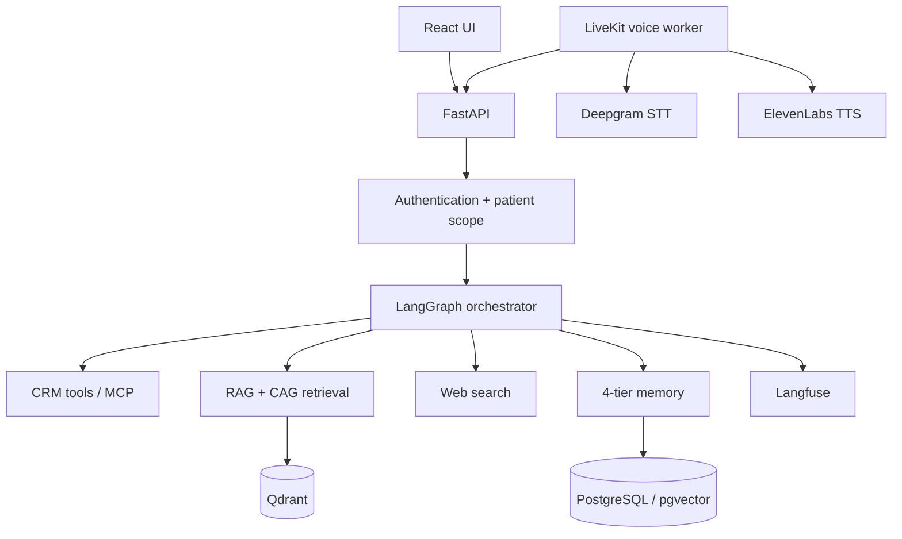

# Auckland Hospital Voice AI

Voice and text healthcare assistant built around a LangGraph multi-agent workflow, patient-scoped access controls, four-tier memory, retrieval, CRM tools, MCP integrations, real-time speech, observability, and containerized deployment.

Seed patient records, FAQ content, and clinical-style examples are synthetic. The application is not a medical device and should not be used for diagnosis, prescribing, or treatment decisions.

## Architecture



The text path uses the multi-agent graph for routing and tool orchestration. The voice path uses a streaming adapter optimized for conversational latency while preserving the same authenticated patient boundary and persistence rules.

## Core capabilities

- patient-scoped authentication and session ownership
- LangGraph orchestration across administrative, clinical-information, direct-response, and web-search paths
- short-term, long-term, episodic, and procedural memory
- PostgreSQL/pgvector and Qdrant retrieval backends
- MCP-backed CRM, memory, crawler, and database tools
- React interface for chat, voice sessions, profile data, and tool activity
- LiveKit voice rooms with Deepgram STT, ElevenLabs TTS, Silero VAD, and interruption handling
- Langfuse traces and structured latency metadata
- background workers for memory persistence and session titling
- Docker Compose and AWS Copilot/ECS deployment configuration

## Security and privacy boundaries

- protected API routes require authenticated bearer identities
- patient records, sessions, and appointments are scoped to the authenticated patient
- local credentials are disabled in production mode
- voice-service callbacks require a separate internal service credential
- OIDC verification supports issuer, audience, signature, expiry, and issued-at validation
- secrets are loaded from environment variables or deployment secret stores
- synthetic seed data is kept separate from production identity and clinical systems

See [SECURITY.md](SECURITY.md) and [NZ_PRIVACY_POLICY.md](NZ_PRIVACY_POLICY.md) for the implemented access model and privacy considerations.

## Local development

Create `.env` from the example and provide the services required for the path you want to run.

```bash
cp .env.example .env
```

Start the API and bundled web application:

```bash
make up
```

Run the voice worker when voice credentials are configured:

```bash
make voice
```

For UI hot reload:

```bash
cd ui
npm ci
npm run dev
```

Use the configured local account flow to obtain an access token. Patient identity is resolved from that token rather than accepted from arbitrary request parameters.

## Voice path

The LiveKit worker streams speech recognition, forwards authenticated turns to the application, and streams synthesized speech back to the room. Barge-in stops playback without discarding committed application work. Only delivered speech is recorded as delivered, and interrupted responses are marked accordingly so later memory does not treat an unfinished answer as fully spoken.

Voice room tokens are issued by the API. Browser clients never receive the LiveKit API secret.

## Memory and retrieval

The memory layer separates:

- short-term conversation state
- long-term semantic memory
- episodic interaction history
- procedural memory for reusable workflows

RAG and CAG paths are bounded by source type and access policy. Patient-specific requests do not use generic cached responses as a substitute for authorized record access.

## API

FastAPI exposes health, authentication, patient, session, chat, voice, and tool endpoints. Interactive API documentation is available from the running service at `/docs`.

The application rejects cross-patient record access at the API boundary and repeats ownership checks in tool/service layers where the request crosses another trust boundary.

## Observability

Application traces can be sent to Langfuse when configured. Voice turns include stage and timing metadata for STT, orchestration, generation, and TTS. Logging avoids storing credentials and uses structured request/session identifiers for correlation.

## Tests

```bash
pytest -q
```

Frontend checks:

```bash
cd ui
npm ci
npm test
npm run build
```

External speech providers, identity providers, and cloud infrastructure require their own credentials and deployment configuration.

## Deployment

The repository includes:

- multi-stage Docker images for API, web, and voice services
- Docker Compose for local orchestration
- AWS Copilot manifests for API, worker, and voice services
- ElastiCache/Redis provisioning assets
- SSM-backed secret configuration
- GitHub Actions deployment using AWS OIDC

Deployment commands are exposed through the Makefile and scripts under `scripts/aws/`.

## Project structure

```text
auckland-hospital-voice-ai/
├── src/
│   ├── agents/                 # orchestration, routing and access policy
│   ├── api/                    # FastAPI routes and authentication
│   ├── infrastructure/         # database, LLM, logging and observability adapters
│   ├── mcp_servers/            # CRM, memory, crawler and retrieval services
│   ├── memory/                 # short/long-term, episodic and procedural memory
│   ├── services/               # chat, CRM and ingestion services
│   ├── voice/                  # LiveKit worker and speech adapters
│   └── workers/                # background jobs
├── ui/                         # React + Vite application
├── tests/                      # access-control and memory tests
├── scripts/                    # seeding, ingestion and deployment utilities
├── sql/                        # schema and synthetic seed data
├── config/                     # model, retrieval and voice configuration
├── docker/                     # container definitions
├── copilot/                    # AWS Copilot manifests
├── docker-compose.yml
├── compose.prod.yml
├── Makefile
└── pyproject.toml
```
